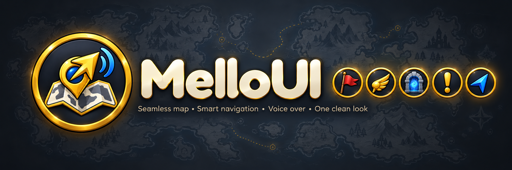

# MelloUI – An All-in-One UI for World of Warcraft: Forever

**Download:** [latest release](https://github.com/MelloCro/MelloUI/releases/latest) · [on CurseForge](https://www.curseforge.com/wow/addons/melloui) · [MelloUI Oldschool](https://www.curseforge.com/wow/addons/melloui-oldschool) (the painted skin) · voice pack, optional: [part 1](https://github.com/MelloCro/MelloUI/releases/download/v0.18.3/MelloUI_VoicePack_Part1.zip) + [part 2](https://github.com/MelloCro/MelloUI/releases/download/v0.18.3/MelloUI_VoicePack_Part2.zip) · [changelog](CHANGELOG.md)

**Discord:** [discord.gg/gdpQ6ep7bW](https://discord.gg/gdpQ6ep7bW) · help, bug reports and every new release

**Support:** [patreon.com/Mello_UI](https://www.patreon.com/Mello_UI) · MelloUI stays free; supporters get a thank-you role on the Discord

*Everything is a switch. On your first login the installer sets MelloUI up with you, fitted to your screen. Type `/mello` for the settings any time.*

## The look

- **Three skins:** Default (the game's own look), Modern (MelloUI's own) and Oldschool (painted RPG art, a separate download).
- **Fonts, bar textures, colours and icons** in one place, and **Dark Mode** for the whole UI.
- **The game's windows** dressed to match, and a **Fader** that hides parts of the UI until you need them.

## Frames and bars

- **Unit frames** for you, your target, focus and pet, with a designer: click a part, drag it.
- **Party and raid frames** with indicators for heals, shields and debuffs.
- **Frame effects:** heals, shields, cooldowns and buffs land on the frames, and a halo shows who has aggro.
- **Personal Display:** your health, power and big cooldowns under your character, and a swing timer.
- **Nameplates** with threat, combo points, crowd control, quest marks and your debuffs; class medallions over your party; glints on herbs, veins and quest items.
- **Action bars, cast bar, XP and reputation bars,** and a **Level Up Card** with your gains and new spells at every level.
- **Minimap** with a Services row (the nearest repair, inn, flight master and more) and one tidy group for other addons' buttons.
- **Damage meter:** a race bar in fights, numbers on your frames and a fight history.

## Chat

- A cleaner chat with channel tabs, chat buttons and a whisper window.

## Quests and travel

- **A world map of its own:** one seamless map with your quests, party, route, dungeons and other addons' pins.
- **Route** finds the quickest way over roads and flights; an arrow and a marker in the world lead you.
- **Quest Tracker** and a **Quest List** of every quest near you.
- **Dungeon Info:** every dungeon's bosses, loot and drop rates.
- **Guide addons:** RestedXP, Follow The Arrow, APR and TomTom steps show on the map, the marker and the tracker, with one arrow at a time.

## Quality of life

- Auto repair and junk selling, **Restock** for your supplies, quests accepted and handed in for you.
- **Reminders** for low supplies, mail, repairs, training and missing buffs.
- Bags sorted by kind, item quality gems, a junk Discard button and cooldown numbers.
- Combat text, gains beside your character, on-screen notices, quieter error messages, FPS and latency, and dark tooltips.

## Sound

- **Voice Over:** quest givers read their text aloud, with subtitles.
- **Custom Sounds** for clicks, windows and alerts, in each skin's style.

## And

- **Edit Layout:** move and size anything, the game's Edit Mode parts too. Your layout follows your screen's shape.
- **Profiles** to save, share and import your setup.
- The settings in English, German, French, Spanish, Portuguese, Russian, Chinese and Korean.

## Install

Download the [release zip](https://github.com/MelloCro/MelloUI/releases/latest) (not GitHub's "Source code" zip), copy every folder in it into `World of Warcraft\_forever_\Interface\AddOns\`, then restart the game. The voice pack's two parts unzip into the same `AddOns` folder; without it, the game's text-to-speech reads instead.

## Credits

- Parts of the configurator's design come from [EllesmereUI](https://www.curseforge.com/wow/addons/ellesmereui), used with its author's kind permission. Thank you!
- The maps of Forever's own dungeons (City of Dalaran, Ruins of Lordaeron, Hall of Thanes, Excavation Site: Wetlands) are by [Santiago Reyes](https://www.artstation.com/artwork/lEG15k), from his "Atlas de Azeroth: Forever" project, used with his kind permission. Thank you! The other dungeon maps are Blizzard's own drawings from the game.
- Dungeon Info's Forever loot: [DungeonMaster](https://www.curseforge.com/wow/addons/dungeonmaster) by MalkDev (GPL-3.0). Drop rates: Data from [Everloot](https://everloot.app), [CC BY-SA 4.0](https://creativecommons.org/licenses/by-sa/4.0/).
- Classic quests, NPCs and drops: the [cmangos classic-db](https://github.com/cmangos/classic-db) (GPL-3.0); the data files made from it are GPL-3.0 too.

<!-- legends:start (written by MBot's `npm run supporters`; empty until there is a Legend) -->
<!-- legends:end -->

## License

MelloUI's code is under the [MIT License](LICENSE). Route's road data is All Rights Reserved ([LICENSE-DATA](LICENSE-DATA)). The data files made from the cmangos classic-db are under the GPL-3.0 ([LICENSE-GPL-3.0.txt](LICENSE-GPL-3.0.txt)).

## Links

[Discord](https://discord.gg/gdpQ6ep7bW) · [Patreon](https://www.patreon.com/Mello_UI) · [Changelog](CHANGELOG.md) · [Report a bug](https://github.com/MelloCro/MelloUI/issues) · [Every feature and command in detail](docs/GUIDE.md)
