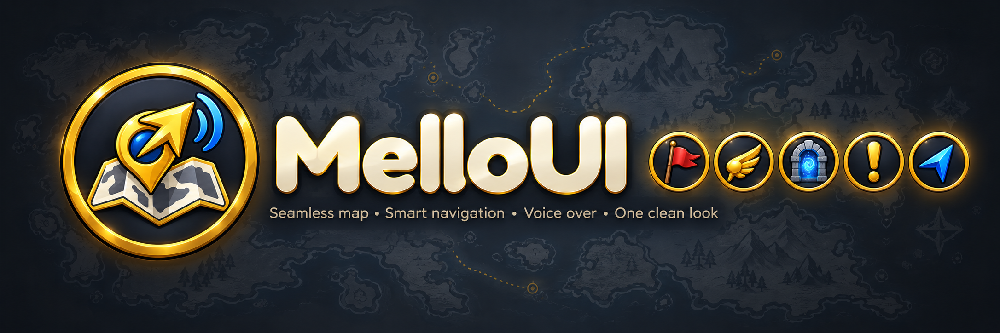

# MelloUI – One Clean UI, a World Map of Its Own & Voiced NPCs

**Download:** [latest release](https://github.com/MelloCro/MelloUI/releases/latest) · [on CurseForge](https://www.curseforge.com/wow/addons/melloui) · voice pack (2.5 GB, optional, two parts, remade for 0.18.3): [part 1](https://github.com/MelloCro/MelloUI/releases/download/v0.18.3/MelloUI_VoicePack_Part1.zip) + [part 2](https://github.com/MelloCro/MelloUI/releases/download/v0.18.3/MelloUI_VoicePack_Part2.zip) · [all releases](https://github.com/MelloCro/MelloUI/releases) · [changelog](CHANGELOG.md)

**Discord:** [discord.gg/gdpQ6ep7bW](https://discord.gg/gdpQ6ep7bW) · help, bug reports and every new release

*Hey! MelloUI is my all-in-one UI for World of Warcraft: Forever. Everything is a switch: a fresh install starts with nothing on, and on your first login the installer sets it up the way you pick, its Full experience fitted to your screen (`/mello install` runs it again any time; `/mello` opens the settings).*

## What's in it

- **One clean look:** MelloUI's own windows, bars and frames in Gilded Slate colours and the Fredoka font, with an icon set that stays sharp at every size.
- **A world map of its own:** one seamless map of the whole world, from Azeroth down to a village, with your party, your route, flight masters, dungeons, quest givers and your quests' objectives on it, and your quest log beside it.
- **Smart navigation:** Route finds the quickest way over roads, open ground and flights, and the World Marker shows it in the world.
- **RestedXP Compatibility:** MelloUI follows RestedXP Guides' steps on the map, the World Marker and the Quest Tracker.
- **Quests:** a Quest Tracker in the chat's look, the Quest List with every quest near you, and voiced quest givers with subtitles.
- **Frames, nameplates and bars:** party and raid frames of MelloUI's own, nameplates that answer the fight, and designers in the settings: click a part on the preview and drag it where you want it.
- **Reminders:** low supplies, new mail, worn gear, new training. One click shows the way; Restock refills your bags when you say Buy.
- **And more:** a chat view of its own, combat text, a damage meter, bags by kind, party markers, cooldown numbers, auto-vendor, dark mode and new UI sounds.
- **Prefer the painted look?** The stone-and-parchment reskin lives on in **MelloUI Oldschool**, a separate download that runs beside MelloUI.

## Install

Download the [release zip](https://github.com/MelloCro/MelloUI/releases/latest) (not GitHub's "Source code" zip) and copy every folder in it, `MelloUI` and each `MelloUI_` folder beside it, into `World of Warcraft\_classic_beta_\Interface\AddOns\`. Then restart the game fully once (`/reload` doesn't find new folders). Each `MelloUI_` folder is one part of MelloUI (the map, Route, the Quest List, the chat ...) and can be switched off in the game's addon list.

**Voice pack (optional, 2.5 GB in two parts, remade for 0.18.3):** download [part 1](https://github.com/MelloCro/MelloUI/releases/download/v0.18.3/MelloUI_VoicePack_Part1.zip) and [part 2](https://github.com/MelloCro/MelloUI/releases/download/v0.18.3/MelloUI_VoicePack_Part2.zip). Had an earlier voice pack? Delete its `MelloUI_VoicePack` folder first. Then unzip both parts into the same `AddOns` folder: they make one `MelloUI_VoicePack` folder next to MelloUI. Tick it in the addon list. It replaces the old `MelloUI_VoiceOverData` pack, so delete that one too. No pack? The game's text-to-speech reads instead.

## Good to know

- The game keeps your settings, and the Profiles page saves and shares them.
- After an update, restart the game once. `/reload` isn't enough for new files.

## Links

[Discord](https://discord.gg/gdpQ6ep7bW) · [Changelog](CHANGELOG.md) · [Report a bug](https://github.com/MelloCro/MelloUI/issues) · [Every feature, command and module in detail](docs/GUIDE.md)
